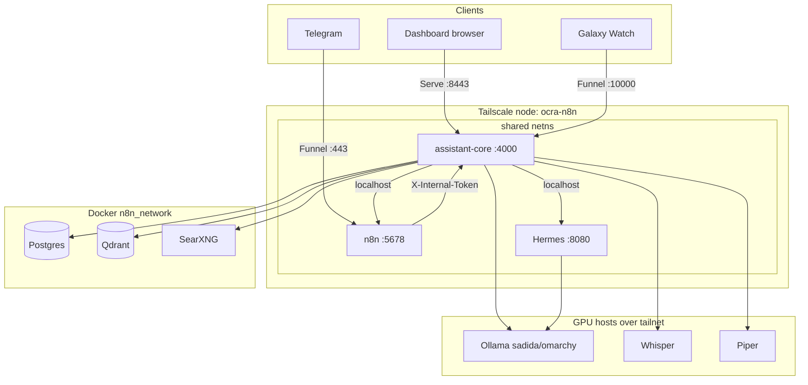

# Rebeca — Architecture

How the pieces fit and communicate. Related: [[Rebeca - Overview]] ·
[[Rebeca - Assistant Core]] · [[Rebeca - Channels, Access & Security]] ·
[[Rebeca - Infrastructure & Ops]].

## Components

| Component | Runtime | Port | Network | Role |
|---|---|---|---|---|
| **assistant-core** | Node/Fastify | 4000 | shares tailscale netns | The brain: chat API, agent loop, memory, voice proxy, auth gate; serves the dashboard + `/watch`. |
| **n8n** | n8n | 5678 | shares tailscale netns | Integration hub: Telegram trigger, slash-command Router, tool sub-workflows (Linear, Calendar). |
| **Hermes gateway** | Node | 8080 | shares tailscale netns | Low-level tools: brain read/write, fs/shell, `ollama_chat`/`claude_chat`. |
| **Tailscale sidecar** | tailscale | — | n8n_network | Shared netns for the three above; publishes host ports; runs Serve/Funnel. Node `ocra-n8n`. |
| **PostgreSQL** | postgres:16 | 5432 | n8n_network | n8n data + Rebeca chat sessions/messages. |
| **Qdrant** | qdrant | 6333 | n8n_network | Vector DB for RAG over the brain. |
| **SearXNG** | searxng | 8080 | n8n_network | Self-hosted metasearch for `web_search`. |
| **Ollama** | external | 11434 | tailnet (sadida, omarchy) | Local LLMs + embeddings (`nomic-embed-text`). |
| **Whisper / Piper** | external | 8100 / 8200 | tailnet (omarchy/sadida) | STT / TTS. |

## System map



## How they reach each other

- assistant-core, n8n and Hermes share the **Tailscale container's network
  namespace** (`network_mode: service:tailscale`), so they call each other on
  `localhost` (`127.0.0.1:8080` Hermes, `127.0.0.1:5678` n8n).
- Postgres, Qdrant, SearXNG live on `n8n_network`; the Tailscale container is also
  on it, so the three siblings resolve them by Docker DNS (`postgres`, `qdrant`,
  `searxng`).
- GPU services are reached by **Tailscale MagicDNS** (`sadida...ts.net`, `omarchy...ts.net`).
- ⚠️ After a reboot the shared netns can desync (see [[Rebeca - Infrastructure & Ops]]).

## Dashboard chat flow

```mermaid
sequenceDiagram
  participant B as Browser
  participant AC as assistant-core
  participant LLM as LLM (Claude/Ollama)
  participant T as Tool backend
  B->>AC: POST /chat/stream (session_id, message, model?)
  Note over AC: auth gate + load session context (Postgres)
  loop agent loop (max 8 steps)
    AC->>LLM: messages + system + tools
    LLM-->>AC: text and/or tool_use
    alt tool calls
      AC->>T: dispatch (builtin / hermes / n8n)
      T-->>AC: result
      AC-->>B: SSE tool_call / tool_result
    else final
      AC-->>B: SSE text
    end
  end
  AC-->>B: SSE model + done ; persist to Postgres
```

SSE events the dashboard consumes: `route` (category), `model` (provider/model/host),
`tool_call`, `tool_result`, `text`, `error`, `done`.

## Data & knowledge flows

- **RAG:** `save_note` → Hermes writes + git push → embed (Ollama
  `nomic-embed-text`) → upsert Qdrant. Query: `search_brain_semantic` → embed →
  Qdrant search. See [[Rebeca - Tools & Capabilities]].
- **Web:** `web_search` → SearXNG JSON API.
- **Metrics:** `query_metrics` / homelab widget → Prometheus. See
  [[Rebeca - Homelab & Metrics]].
