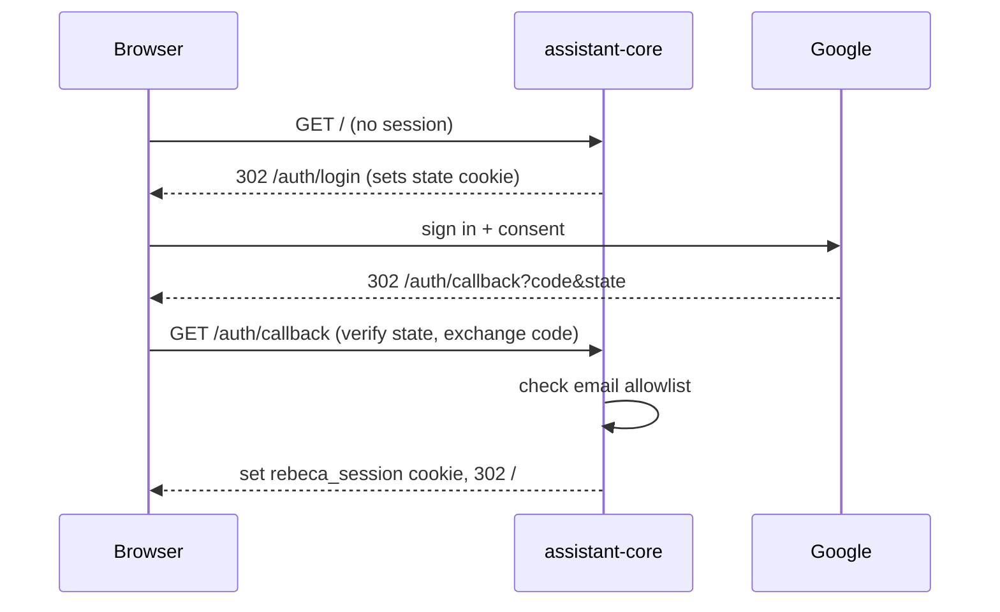

# Rebeca — Channels, Access & Security

How each channel reaches Rebeca and how access is controlled. Related:
[[Rebeca - Architecture]] · [[Rebeca - Assistant Core]] · [[Rebeca - Voice & Watch]].

## Channels

| Channel | Entry | Auth | Voice |
|---|---|---|---|
| Dashboard | Serve `:8443` (tailnet-only) | Google OAuth | mic push-to-talk + TTS |
| Watch | Funnel `:10000` (public) | Watch token | mic push-to-talk + TTS |
| Telegram | Funnel `:443` → n8n | Internal token | voice notes in; text out |

## Tailscale exposure (node `ocra-n8n.stegosaurus-panga.ts.net`)

Tailscale allows Funnel only on ports **443, 8443, 10000**.

| Port | Mode | Target | Purpose |
|---|---|---|---|
| 443 | **Funnel** (public) | `127.0.0.1:5678` (n8n) | Telegram webhook |
| 8443 | **Serve** (tailnet-only) | `127.0.0.1:4000` (assistant-core) | Dashboard |
| 10000 | **Funnel** (public) | `127.0.0.1:4000` (assistant-core) | Watch access |

Re-create the watch funnel if lost (e.g. power outage):
`sudo docker exec n8n_tailscale tailscale funnel --bg --https=10000 http://127.0.0.1:4000`

## Auth gate (assistant-core `onRequest`)

Order of checks:
1. `/health` and `/auth/*` → open.
2. **Internal token** — `X-Internal-Token: <INTERNAL_TOKEN>` (n8n/Telegram → Rebeca)
   bypasses OAuth. Used for `/chat`, `/voice/*`, brain index hooks.
3. **Watch token** — `?wt=<WATCH_TOKEN>` sets a signed cookie (`rebeca_watch`, 30d),
   authorizing ONLY `/watch`, `/watch.html`, `/chat`, `/chat/stream`, `/voice/*`.
   A leaked watch token can't open the rest of the dashboard.
4. **Google session cookie** — signed `rebeca_session` (7d), email in
   `ALLOWED_GOOGLE_EMAILS`.
5. else → HTML GET redirects to `/auth/login`, others `401`.

## Google OAuth (OIDC)

Redirect URI: `https://ocra-n8n.stegosaurus-panga.ts.net:8443/auth/callback`
(tailnet Serve). Because it's tailnet-only, the off-tailnet **watch** can't complete
Google login → hence the watch token.

## Secrets (`.env`, never committed)

`ANTHROPIC_API_KEY`, `INTERNAL_TOKEN`, `WATCH_TOKEN`, `SESSION_SECRET`,
`GOOGLE_CLIENT_ID/SECRET`, `SEARXNG_SECRET`, `POSTGRES_PASSWORD`, `TS_AUTHKEY`,
`ALLOWED_GOOGLE_EMAILS`, `PROMETHEUS_URL`. Linear API key lives in the n8n
credential, not in `.env` or workflow JSON.

## Posture

- Dashboard stays tailnet-only; the assistant is public only via the watch Funnel,
  gated by the watch token (and OAuth for everything else). Don't expose it further.
- HTTPS everywhere (Tailscale terminates with a valid `ts.net` cert), which also
  makes the browser mic work.
